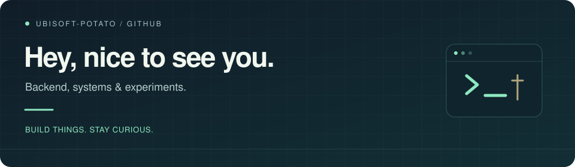

  

  <a href="https://ubisoft-potato.github.io/">Website</a> ·
  <a href="mailto:1354250064mdzz@gmail.com">Email</a> ·
  <a href="https://github.com/Ubisoft-potato?tab=repositories">Repositories</a> ·
  <a href="https://www.codewars.com/users/Ubisoft-potato">Codewars</a>

### A little about me

I build across backend services, systems tooling and native apps, with a soft spot for small experiments that turn into real projects.

Recently: a native macOS wallet, AI agents for security testing, and a Chinese language model trained from scratch.

### Languages & tools

  
  
  
  
  
  
  

  
  
  
  

**Backend & data** · Spring · MySQL · Redis · Kafka  
**Workflow** · GitHub Actions · IntelliJ IDEA · Vim · VS Code · Markdown

### Selected projects

| Project | What I'm building | Stack |
| :--- | :--- | :--- |
| [**Veil Wallet**](https://github.com/Ubisoft-potato/VeilWallet) | A native macOS wallet for local keys and multichain assets. Development preview. | Swift · SwiftUI · AppKit |
| [**ARTEX**](https://github.com/Ubisoft-potato/ARTEX) | An AI agent system for autonomous penetration testing. | Go · Next.js |
| [**ruozhi**](https://github.com/Ubisoft-potato/ruozhi) | A small Chinese language model: pretraining, fine-tuning and chat, with a sense of humor. | Python · LLM training |

[Explore more repositories →](https://github.com/Ubisoft-potato?tab=repositories)

### On GitHub

  

  <a href="https://github.com/Ubisoft-potato?tab=overview">Contribution activity</a> ·
  <a href="https://github.com/Ubisoft-potato/Ubisoft-potato/actions/workflows/blank.yml">Metrics updates</a>

---

Build things. Stay curious.

